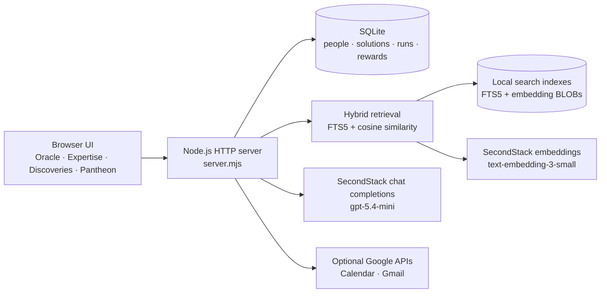

# PYTHIA current architecture

This document describes the application implemented in the `anastasia/local` branch. The longer [PYTHIA-architecture-and-logic.md](./PYTHIA-architecture-and-logic.md) describes the broader target architecture and contains planned components that are not implemented yet.

## Runtime overview

PYTHIA is currently a local Node.js application built without third-party runtime dependencies. It serves a static HTML/CSS/JavaScript interface, exposes JSON endpoints, and stores application data and search indexes in SQLite.



The default server binds to `127.0.0.1:3000`. Secrets are read from `.env.local`, which overrides `.env` and is excluded from Git.

## Oracle request flow

`POST /api/oracle/chat` is the main Seek Wisdom endpoint.


The model must choose one of three recommendation types:

- `solution`: one existing catalogue solution and optionally up to three people;
- `person`: up to three colleagues with relevant expertise;
- `build`: a proposed skill or agent with implementation steps.

The model cannot select arbitrary records. Returned solution and person IDs are checked against the retrieved candidate set. Invalid IDs are discarded; an invalid solution recommendation becomes `build`.

## Hybrid candidate retrieval

Hybrid retrieval is implemented in `lib/retrieval.mjs` and combines two independent signals.

### Semantic similarity

SecondStack `text-embedding-3-small` creates 1,536-dimensional vectors. Vectors are stored locally as Float32 BLOBs in `search_embeddings`. Search uses cosine similarity.

Employee embedding documents contain only:

- role;
- team;
- skills;
- professional experience description.

They deliberately exclude name, initials, location, availability, contact details, rewards, and activity history. Solution documents contain title, type, summary, and runnable status.

### Exact local search

SQLite FTS5 indexes role, team, skills, experience, solution title, type, and summary using the Unicode tokenizer. It catches exact systems and product names such as `Salesforce`, `SAP`, `Jira`, and `Unity Catalog` that semantic retrieval might rank less precisely.

Candidate scores currently use:

```text
72% semantic cosine similarity
28% FTS5 rank
```

If embeddings are unavailable, retrieval automatically switches to exact-only FTS5 mode. No database content is sent to the embedding service in that mode.

### Index lifecycle

Every embedding row records its entity type, entity ID, model, dimensions, content hash, vector, and update time.

An employee is re-indexed when:

- a profile is created with `POST /api/people`;
- a skill is confirmed with `POST /api/skills/confirm`;
- role, team, skills, or experience changes through `PATCH /api/people/:id`.

At startup, all FTS5 rows are refreshed. Embeddings are requested only when the searchable content hash changed or when `EMBEDDING_MODEL` changed. This prevents repeated embedding calls for unchanged records.

## Privacy boundary

Names remain in local SQLite and are never included in employee embedding text or in the LLM candidate prompt. The LLM receives a candidate ID, role, team, skills, experience, and retrieval scores. After it returns validated `peopleIds`, the server resolves those IDs to names locally for display.

The user's Seek message is sent to SecondStack twice: once for its query embedding and once as part of the LLM conversation. Profile role, team, skills, and professional experience are sent when their embeddings are created and when a profile is included among the top five LLM candidates. Sensitive personal or HR data must not be stored in these searchable fields.

## Failure modes

- If embeddings fail, Oracle uses exact FTS5 retrieval.
- If the chat model fails, Oracle uses its deterministic local recommendation fallback over the retrieved candidates.
- If both external services are unavailable, the application remains usable with local exact search.
- Google Calendar and Gmail are optional; Calendar Breather uses seeded demo data when Google is not connected.

## Configuration

```dotenv
LLM_BASE_URL=https://secondstack.t1a.io/gateway/api/v1
LLM_API_KEY=
LLM_MODEL=gpt-5.4-mini
LLM_PROVIDER_NAME=SecondStack
LLM_TIMEOUT_MS=45000
EMBEDDING_MODEL=text-embedding-3-small
```

See the [Oracle LLM setup guide](../Setup/ORACLE-LLM-SETUP.md) and [Google setup guide](../Setup/GOOGLE-SETUP.md) for setup details.

## Current limitations and next integrations

- Published SecondStack agents are not imported automatically. Calendar Breather and the other catalogue records are local seeded solutions.
- There is no generic remote-agent invocation protocol yet. Finding an agent and running it are separate integrations.
- Search compares vectors in application memory. This is appropriate for the current small dataset; a larger deployment should move vector search to `sqlite-vec` or Postgres with pgvector.
- Profiles have no field-level access-control model yet. Permission filtering must be applied before retrieval in a multi-tenant deployment.
- The MCP endpoint and SecondStack/ControlTower catalogue synchronization described in the target architecture are still planned work.

