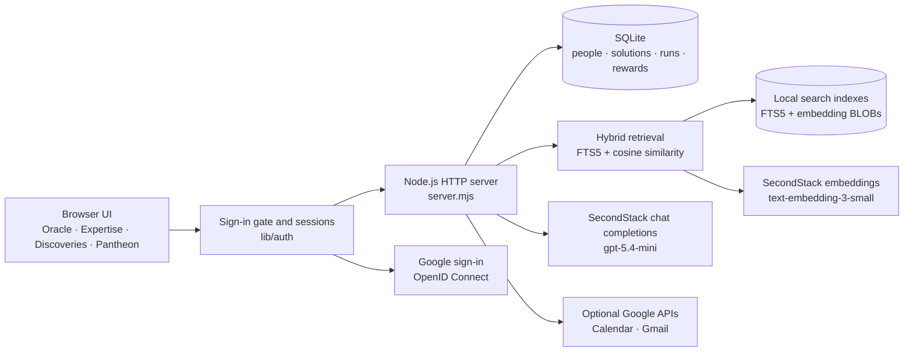

# PYTHIA current architecture

This document describes the application implemented in the `anastasia/local` branch. The longer [PYTHIA-architecture-and-logic.md](./PYTHIA-architecture-and-logic.md) describes the broader target architecture and contains planned components that are not implemented yet.

## Runtime overview

PYTHIA is currently a local Node.js application built without third-party runtime dependencies. It serves a static HTML/CSS/JavaScript interface, exposes JSON endpoints, and stores application data and search indexes in SQLite.



The default server binds to `127.0.0.1:3000`. Secrets are read from `.env.local`, which overrides `.env` and is excluded from Git.

### Local database and seed lifecycle

The local database is created at `data/pythia.db`. Shared demo records come from the versioned `seed/mockup-seed.json`; the applied version is stored in `app_meta`. Seed updates use idempotent upserts so a normal application restart can update shared demo records without clearing locally created activity.

For a deterministic clean start, stop the application and run `npm run db:reset`. The reset command archives the current SQLite files under `data/backups/`, creates a new database, applies the current schema and seed, and exits without starting the HTTP server or requesting embeddings. Search indexes are rebuilt on the next normal application start.

## Authentication and sessions

Every page and API call except the login page requires a session. The code lives in `lib/auth/` and wraps the request handler in `server.mjs`, so route handlers never see an unauthenticated request.

**Sign-in methods.**

- *Google* (`GET /auth/login` → Google → `GET /auth/google/callback`): OpenID Connect authorization-code flow with PKCE (S256), a `state` value bound to a short-lived `pythia_oauth` cookie (blocks login CSRF), and a `nonce`. Only identity scopes are requested (`openid email profile`). The ID token is accepted only when `iss`, `aud`, `exp` and `nonce` match, `email_verified` is true, the email domain is in `AUTH_ALLOWED_DOMAINS` (default `t1a.com`) and the `hd` claim names the same domain. The token comes straight from Google's token endpoint over TLS, so its signature is not verified a second time.
- *Demo persona* (`POST /auth/dev-login`, development login): pick a seeded colleague. It is on when `AUTH_DEV_LOGIN=1`, or when the variable is empty and no Google credentials are configured; it is always off when `NODE_ENV=production`. The startup log states which methods are active.

The Google calendar/mail connection (`/auth/google`, same redirect URI) is a separate flow that runs only for a signed-in user. The callback tells the two flows apart by looking up `state` in the sign-in flow's pending map and falls through to the connection flow otherwise.

**Sessions.** A successful sign-in creates a random opaque token, sent as the `pythia_session` cookie (`HttpOnly`, `SameSite=Lax`, `Secure` when the redirect URI is https). Only its SHA-256 hash is stored in the `sessions` table (`id_hash`, `user_id`, `method`, `created_at`, `expires_at`). Sessions last `SESSION_TTL_HOURS` (default 12), expired rows are purged when a new session starts, and `POST /auth/logout` deletes the row. Signing in again destroys the previous session of that browser.

**Request identity.** The gate resolves the cookie to a user and runs the rest of the request inside an `AsyncLocalStorage` scope (`lib/auth/context.mjs`). `resolveUserId()` in `server.mjs` returns that user and ignores any `userId` in the body or query string, so a client cannot act as someone else. Ownership rules that depend on it:

- a run can be rated, and break invitations added to it, only by the person who ran it (`403` otherwise);
- `POST /api/people` creates or completes the *caller's own* profile (`409` if another profile already has the name);
- `PATCH /api/people/:id` accepts only the caller's own id (`403` otherwise).

**Gate behaviour.** Without a session, `/api/*` answers `401` (`{"code":"auth_required"}`); `GET /login.html`, `/login.js`, `/style.css` and `/favicon.ico` stay public; other page and `/auth/*` GETs redirect to `/login.html`. State-changing requests carrying `Sec-Fetch-Site: cross-site`, or an `Origin` that differs from `Host`, get `403`.

**Users.** `ensureAuthSchema` adds `email`, `google_sub`, `avatar_url`, `last_login_at` and `profile_completed` to `users` (unique indexes on `lower(email)` and `google_sub`) and creates `sessions`; existing databases keep all their records, and existing profiles stay complete. A Google sign-in is linked to a profile in this order: `google_sub`, then email, then an unclaimed seed profile with the same normalized name, otherwise a new profile is created with placeholder role/team/skills and `profile_completed=0`. The UI then opens a "Welcome" dialog until the person saves their role and skills.

The first-login dialog includes an optional LLM drafting step. `POST /api/profile/analyze` accepts a free-text professional introduction and returns validated role, team/practice, skills, and experience fields. The response only prefills the form: the introduction is not stored, the draft does not change SQLite, and the person must review and submit the normal profile form. Onboarding never publishes catalogue solutions; reusable tools and agents require the separate Share Wisdom review flow.

**Google Calendar and Gmail tokens** are stored per user in `data/google-tokens/<user id>.json` (mode `0600`, never committed). A token is released only to the account it was issued for: if the signed-in profile has an email that differs from the token's, the token is ignored, which also protects against ids being reassigned after `npm run db:reset`. Connecting a Google account other than the one signed in is refused and the grant is revoked. A pre-auth `data/google-token.json` is adopted by the user whose email matches.

**Verification status.** Covered by `npm test` with a fake Google endpoint: token validation (domain, `hd`, nonce, unverified email), PKCE and state handling, session lifecycle, the gate, ownership checks and per-user token files. Verified live: Google sign-in with a real `t1a.com` account (persona login off). Not verified live yet: connecting Calendar/Gmail after sign-in, and the first-sign-in profile creation for a brand-new account.

## Oracle request flow

`POST /api/oracle/chat` is the main Seek Wisdom endpoint.


The model must choose one of three recommendation types:

- `solution`: one existing catalogue solution and optionally up to three people;
- `person`: up to three colleagues with relevant expertise;
- `build`: a proposed skill or agent with implementation steps.

The model cannot select arbitrary records. Returned solution and person IDs are checked against the retrieved candidate set. Invalid IDs are discarded; an invalid solution recommendation becomes `build`.

## Share Wisdom flow

Share Wisdom mirrors the prototype's review-first flow. `POST /api/share/analyze` sends the colleague's free-text offering to the configured SecondStack chat model. `lib/wisdom.mjs` asks for bounded structured JSON containing profile skills, experience evidence, and reusable solutions (`skill`, `agent`, `automation`, `guide`, `tool`, or `knowledge`). The server validates and truncates every model-produced field before returning a review draft. If the model is unavailable, a deterministic local extractor provides a clearly labelled fallback draft.

Nothing is written during analysis. The colleague can edit or deselect every extracted item. `POST /api/share` then stores the original contribution, merges confirmed skills and experience into the signed-in user's profile, and inserts confirmed non-duplicate solutions into the local catalogue. Newly shared agents are catalogue records only and remain non-runnable until a real executor is integrated. The updated profile and new solutions are immediately added to FTS5 and, when configured, their embeddings are refreshed.

## Hybrid candidate retrieval

Hybrid retrieval is implemented in `lib/retrieval.mjs` and combines two independent signals.

### Semantic similarity

SecondStack `text-embedding-3-small` creates 1,536-dimensional vectors. Vectors are stored locally as Float32 BLOBs in `search_embeddings`. Search uses cosine similarity.

Employee embedding documents contain only:

- role;
- team;
- skills;
- professional experience description.

They deliberately exclude name, initials, location, availability, contact details, rewards, and activity history. Solution documents contain title, type, summary, and runnable status.

### Exact local search

SQLite FTS5 indexes role, team, skills, experience, solution title, type, and summary using the Unicode tokenizer. It catches exact systems and product names such as `Salesforce`, `SAP`, `Jira`, and `Unity Catalog` that semantic retrieval might rank less precisely.

Candidate scores currently use:

```text
72% semantic cosine similarity
28% FTS5 rank
```

If embeddings are unavailable, retrieval automatically switches to exact-only FTS5 mode. No database content is sent to the embedding service in that mode.

### Index lifecycle

Every embedding row records its entity type, entity ID, model, dimensions, content hash, vector, and update time.

An employee is re-indexed when:

- a profile is created with `POST /api/people`;
- a skill is confirmed with `POST /api/skills/confirm`;
- role, team, skills, or experience changes through `PATCH /api/people/:id`.
- confirmed Share Wisdom skills or experience are saved with `POST /api/share`.

A solution is indexed when it is confirmed through Share Wisdom. Exact title matches already in the catalogue are reported as duplicates and are not inserted again.

At startup, all FTS5 rows are refreshed. Embeddings are requested only when the searchable content hash changed or when `EMBEDDING_MODEL` changed. This prevents repeated embedding calls for unchanged records.

## Privacy boundary

Names remain in local SQLite and are never included in employee embedding text or in the LLM candidate prompt. The LLM receives a candidate ID, role, team, skills, experience, and retrieval scores. After it returns validated `peopleIds`, the server resolves those IDs to names locally for display.

Email addresses, Google account ids, sessions and Calendar/Gmail tokens stay in local SQLite and `data/`; they are not part of employee embedding text or the LLM prompt. The Oracle acts on behalf of the signed-in person only.

The user's Seek message is sent to SecondStack twice: once for its query embedding and once as part of the LLM conversation. A Share Wisdom message is sent once to the chat model for extraction; the prompt includes the active profile's role, team, and skills but not the person's name or account identifiers. An onboarding introduction is sent only when the person explicitly clicks **Extract with Pythia**; it is used to draft the form and is not stored. Profile role, team, skills, and professional experience are sent when their embeddings are created and when a profile is included among the top five LLM candidates. Sensitive personal or HR data must not be stored in these searchable fields.

## Failure modes

- If embeddings fail, Oracle uses exact FTS5 retrieval.
- If the chat model fails, Oracle uses its deterministic local recommendation fallback over the retrieved candidates.
- If Share Wisdom extraction fails, the review screen uses its deterministic local extractor and labels that mode before anything can be saved.
- If both external services are unavailable, the application remains usable with local exact search.
- Google Calendar and Gmail are optional; Calendar Breather uses seeded demo data when Google is not connected.
- If Google sign-in is not configured, the demo persona login keeps the application usable; once Google credentials are set, persona login is off unless `AUTH_DEV_LOGIN=1`.

## Configuration

```dotenv
LLM_BASE_URL=https://secondstack.t1a.io/gateway/api/v1
LLM_API_KEY=
LLM_MODEL=gpt-5.4-mini
LLM_PROVIDER_NAME=SecondStack
LLM_TIMEOUT_MS=45000
EMBEDDING_MODEL=text-embedding-3-small

AUTH_ALLOWED_DOMAINS=t1a.com
AUTH_DEV_LOGIN=
SESSION_TTL_HOURS=12
```

`AUTH_DEV_LOGIN`: `1` on, `0` off, empty means on only while Google credentials are empty. `AUTH_COOKIE_SECURE=1` forces the `Secure` cookie flag (automatic when `GOOGLE_REDIRECT_URI` is https). The Google OAuth variables are described in the Google setup guide.

See the [Oracle LLM setup guide](../Setup/ORACLE-LLM-SETUP.md) and [Google setup guide](../Setup/GOOGLE-SETUP.md) for setup details.

## Current limitations and next integrations

- Published SecondStack agents are not imported automatically. Calendar Breather and the other catalogue records are local seeded solutions.
- There is no generic remote-agent invocation protocol yet. Finding an agent and running it are separate integrations.
- Search compares vectors in application memory. This is appropriate for the current small dataset; a larger deployment should move vector search to `sqlite-vec` or Postgres with pgvector.
- Authentication identifies people but there are no roles: every signed-in colleague can read all profiles and the catalogue. Sign-in has no rate limiting, and sessions live in the local SQLite file of a single process.
- Profiles have no field-level access-control model yet. Permission filtering must be applied before retrieval in a multi-tenant deployment.
- The MCP endpoint and SecondStack/ControlTower catalogue synchronization described in the target architecture are still planned work.
