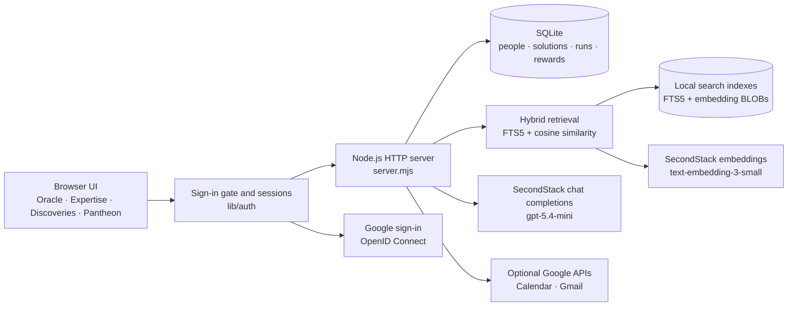
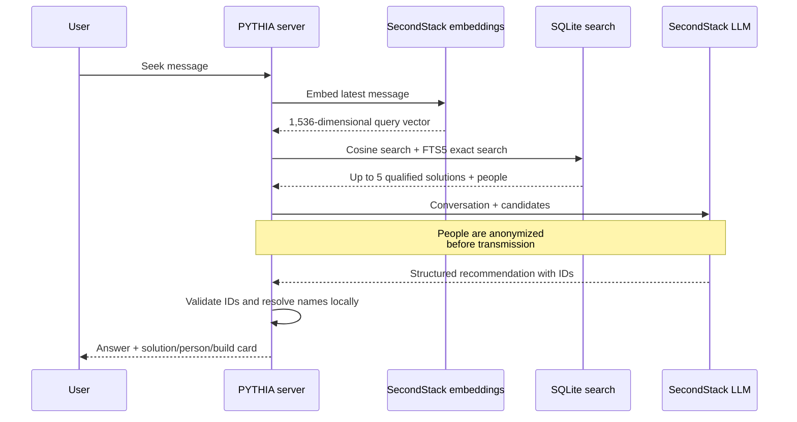

# PYTHIA current architecture

This document describes the application implemented in the `anastasia/local` branch. The longer [PYTHIA-architecture-and-logic.md](./PYTHIA-architecture-and-logic.md) describes the broader target architecture and contains planned components that are not implemented yet.

## Runtime overview

PYTHIA is currently a local Node.js application built without third-party runtime dependencies. It serves a static HTML/CSS/JavaScript interface, exposes JSON endpoints, and stores application data and search indexes in SQLite.



The default server binds to `127.0.0.1:3000`. Settings are read from `.env`, then `.env.local`; a later line overrides an earlier one, including an empty value. Both files are excluded from Git.

### Local database and seed lifecycle

The local database is created at `data/pythia.db`. Shared demo records come from the versioned `seed/mockup-seed.json`; the applied version is stored in `app_meta`. Seed updates use idempotent upserts so a normal application restart can update shared demo records without clearing locally created activity.

For a deterministic clean start, stop the application and run `npm run db:reset`. The reset command archives the current SQLite files under `data/backups/`, creates a new database, applies the current schema and seed, and exits without starting the HTTP server or requesting embeddings. Search indexes are rebuilt on the next normal application start.

## Authentication and sessions

Every page and API call except the login page requires a session. The code lives in `lib/auth/` and wraps the request handler in `server.mjs`, so route handlers never see an unauthenticated request.

**Sign-in methods.**

- *Google* (`GET /auth/login` → Google → `GET /auth/google/callback`): OpenID Connect authorization-code flow with PKCE (S256), a `state` value bound to a short-lived `pythia_oauth` cookie (blocks login CSRF), and a `nonce`. Only identity scopes are requested (`openid email profile`). The ID token is accepted only when `iss`, `aud`, `exp` and `nonce` match, `email_verified` is true, the email domain is in `AUTH_ALLOWED_DOMAINS` (default `t1a.com`) and the `hd` claim names the same domain. The token comes straight from Google's token endpoint over TLS, so its signature is not verified a second time.
- *Demo persona* (`POST /auth/dev-login`, development login): pick a seeded colleague. It is on when `AUTH_DEV_LOGIN=1`, or when the variable is empty and no Google credentials are configured; it is always off when `NODE_ENV=production`. The startup log states which methods are active.

The Google calendar/mail connection (`/auth/google`, same redirect URI) is a separate flow that runs only for a signed-in user. The callback tells the two flows apart by looking up `state` in the sign-in flow's pending map and falls through to the connection flow otherwise.

**Sessions.** A successful sign-in creates a random opaque token, sent as the `pythia_session` cookie (`HttpOnly`, `SameSite=Lax`, `Secure` when the redirect URI is https). Only its SHA-256 hash is stored in the `sessions` table (`id_hash`, `user_id`, `method`, `created_at`, `expires_at`). Sessions last `SESSION_TTL_HOURS` (default 12), expired rows are purged when a new session starts, and `POST /auth/logout` deletes the row. Signing in again destroys the previous session of that browser.

**Request identity.** The gate resolves the cookie to a user and runs the rest of the request inside an `AsyncLocalStorage` scope (`lib/auth/context.mjs`). `resolveUserId()` in `server.mjs` returns that user and ignores any `userId` in the body or query string, so a client cannot act as someone else. Ownership rules that depend on it:

- a run can be rated, and break invitations added to it, only by the person who ran it (`403` otherwise);
- `POST /api/people` creates or completes the *caller's own* profile (`409` if another profile already has the name);
- `PATCH /api/people/:id` accepts only the caller's own id (`403` otherwise).

**Input limits and errors.** `body()` in `server.mjs` reads JSON up to 256 KB (`413` beyond that, and the connection is closed), answers `400` for malformed JSON or anything but a JSON object, and the Oracle, Seek, Share and contribution texts stay at 4,000 characters; voice uploads keep their own 12 MB limit and the auth endpoints their 16 KB limit. `/api/run` accepts a `requestId` only if it is one of the caller's own requests (`403` otherwise), and every `timeZone` is checked against `Intl` (`400`). An unknown or inherited-property `period` (`toString`, `__proto__`, …) falls back to `30d`. A malformed URL path answers `400`. Upstream (Google or LLM) failures answer `502` with their message, except programming errors (`TypeError`, `RangeError`, …), which return a generic message and are logged. Helped confirmations pay once per confirming colleague, solution and month and at most five per colleague per week (see the gamification framework).

**Overview payload.** `GET /api/overview` is shared by every signed-in user, so it returns only what the UI renders: the directory fields of `people` (`id`, `name`, `title`, `team`, `skills`, `honorific`, `initials`, `color`, `location`, `availability`, `experience`) with points and level, the Pantheon, gratitude, the catalogue and the caller's own `requests` (newest 100, no asker name). Account data (`email`, `google_sub`, `last_login_at`, `avatar_url`), other colleagues' requests and run results are not included; the former `runs` and `events` lists were unused and have been removed.

**Gate behaviour.** Without a session, `/api/*` answers `401` (`{"code":"auth_required"}`); `GET /login.html`, `/login.js`, `/style.css` and `/favicon.ico` stay public; other page and `/auth/*` GETs redirect to `/login.html`. State-changing requests carrying `Sec-Fetch-Site: cross-site`, or an `Origin` that differs from `Host`, get `403`.

**Users.** `ensureAuthSchema` adds `email`, `google_sub`, `avatar_url`, `last_login_at` and `profile_completed` to `users` (unique indexes on `lower(email)` and `google_sub`) and creates `sessions`; existing databases keep all their records, and existing profiles stay complete. A Google sign-in is linked to a profile in this order: `google_sub`, then email, then an unclaimed seed profile with the same normalized name, otherwise a new profile is created with placeholder role/team/areas of expertise and `profile_completed=0`. The UI then opens a "Welcome" dialog until the person saves their role and areas of expertise. The SQLite column remains `users.skills` for backward compatibility; product language and LLM contracts call these values **areas of expertise**.

The first-login dialog includes an optional LLM drafting step. `POST /api/profile/analyze` accepts a free-text professional introduction and returns validated role, team/practice, areas of expertise, and experience fields. The response only prefills the form: the introduction is not stored, the draft does not change SQLite, and the person must review and submit the normal profile form. Onboarding never publishes catalogue solutions; reusable tools and agents require the separate Share Wisdom review flow.

Every expertise write path uses the same canonical normalization in `lib/expertise.mjs`: Unicode compatibility normalization, collapsed internal whitespace, trimmed edges, and case-insensitive comparison. The first entered spelling is preserved for display. This deduplicates variants such as `CRM`, ` crm `, and `CRM   ` within one profile without merging distinct concepts such as `CRM` and `CRM automation`. The rule is applied to profile creation and editing, LLM extraction, confirmed suggestions, Share Wisdom, seed loading, and a one-time migration of existing local profiles.

The Expertise directory filter chips are built only from recurring employees' areas of expertise; team/practice values are not presented as expertise filters. One-off expertise remains available through free-text search, which includes name, role, team/practice, location, and all areas of expertise. A team or practice therefore remains searchable without being mislabeled as a skill.

**Google Calendar and Gmail tokens** are stored per user in `data/google-tokens/<user id>.json` (mode `0600`, never committed). A token is released only to the account it was issued for: if the signed-in profile has an email that differs from the token's, the token is ignored, which also protects against ids being reassigned after `npm run db:reset`. Connecting a Google account other than the one signed in is refused and the grant is revoked. A pre-auth `data/google-token.json` is adopted by the user whose email matches.

**Verification status.** Covered by `npm test` with a fake Google endpoint: token validation (domain, `hd`, nonce, unverified email), PKCE and state handling, session lifecycle, the gate, ownership checks and per-user token files. Verified live: Google sign-in with a real `t1a.com` account (persona login off). Not verified live yet: connecting Calendar/Gmail after sign-in, and the first-sign-in profile creation for a brand-new account.

## Oracle request flow

## Calendar recovery planning

Calendar Breather's run flow is session-owned and requires that user's linked Google Calendar token. `POST /api/calendar/plan-preview` starts or updates a persistent local automation job. The job runs once daily or once weekly, analyzes a rolling seven-day window, generates break candidates only Monday through Friday, and previews only those working days. Timed and all-day events block conflicting weekday slots; weekend events are omitted from the preview. The user chooses Gentle, Balanced, or Extra room mode and a daily or weekly analysis cadence. PYTHIA chooses the count, timing, and duration (5, 7, 8, 9, 10, or 15 minutes); the mode sets the degree of support, not a fixed break count. On every pass, the Oracle analyzes calendar load and chooses a total target for the rolling seven-day window, counting existing holds in that window so later passes do not duplicate them. Preferences are stored in `calendar_preferences`; job cadence and next/last run state are stored in `calendar_automation_jobs`. By default the Oracle receives only sanitized calendar-load counts and free-slot metadata; Gmail and event content stay local. Context analysis is enabled by default and can be switched off. When enabled, it reads up to 90 days of prior meetings and recent Gmail subjects/snippets for external attendee addresses on matching company domains. The server sends only sanitized company keys, relevant meeting titles/dates, and a bounded sample of subjects/snippets to SecondStack. Addresses and full email bodies are excluded. The server computes same-company meeting ordinals, counts earlier long sessions, and summarizes load by weekday. A third long session with the same company is sent as an accumulated-pressure signal. The planner gives at least one suggestion to every weekday with a valid candidate, distributes further suggestions across distinct days, and enforces a mode-based per-day ceiling; its local fallback follows that distribution too. It keeps at least 30 minutes of open time between PYTHIA breaks, considering existing holds and new suggestions; the server enforces this again before proposals are returned or written. The model can recommend only server-generated slot keys; context-triggered pre-meeting slots are exactly 15 minutes and must fit the planning window and remain clear of calendar conflicts. The LLM analyzes tone from supplied meeting titles, bounded related snippets, and prior meeting titles, then favors spaced breaks through demanding workdays. A local workload fallback remains if the model is unavailable, without LLM sentiment analysis. The UI describes data sharing before opt-in, surfaces Google reauthorization errors, shows planning errors inside the modal, and previews weekdays in the seven-day window with existing events and proposed PYTHIA breaks. A previous-week replay is read-only: it creates no database proposals or Google Calendar events. The scheduler runs while the local server process is running and resumes overdue jobs once after restart.

Each automation pass creates only the additional private tentative holds selected by the Oracle for the rolling seven-day window. These are holds on the user's own primary calendar, not email invitations from a separate organizer and not Google RSVP requests. `GET /api/calendar/pending` lists them; `POST /api/calendar/invitations/:id/respond` verifies ownership and lets the user accept (change event to confirmed) or decline (delete event). Accept/Decline buttons bind to rendered cards in both the run result and Connections views, and show request failures beside the invitation. Both views offer an Accept all action for pending holds. The result view can also request a previous-week replay; those simulated break blocks have no response actions. Legacy recurring-series endpoints remain available for series created by the earlier flow. The scheduler runs only while the local server process is running; overdue work is analyzed once when the app restarts.

`calendar_proposals` stores candidate times, activity theme, response state, and Google event ID. Google token access remains per-user. Calendar planning does not silently fall back to demo data when a signed-in user has not connected Google.

The older general calendar analysis endpoint still supports Google Calendar/Gmail analysis and the legacy demo run; that flow is separate from the calendar-only recovery planner.

## Oracle request flow

### Seek Wisdom search and retrieval

`POST /api/oracle/chat` is the main Seek Wisdom endpoint.

Seek Wisdom and Share Wisdom also expose optional browser voice input through the same composer component. In browsers with `MediaRecorder`, the microphone records locally until the colleague presses it again (or the 60-second limit is reached), then sends the audio to the signed-in-only `POST /api/transcribe` endpoint. The server forwards recordings of up to 12 MB to SecondStack's OpenAI-compatible `/audio/transcriptions` endpoint using `TRANSCRIPTION_MODEL` (`gpt-4o-mini-transcribe` by default). The editable transcript is inserted into the existing text area and is never submitted automatically. Browsers without `MediaRecorder` fall back to the Web Speech API when available; denied microphone permission always leaves typing available.



The model must choose one of three recommendation types:

- `solution`: one existing catalogue solution and optionally up to three people;
- `person`: up to three colleagues with relevant expertise;
- `build`: a proposed skill or agent with implementation steps.

The model cannot select arbitrary records. Returned solution and person IDs are checked against the retrieved candidate set. Invalid IDs are discarded; an invalid solution recommendation becomes `build`.

Structured-output validation also reconciles prose with IDs: if the answer explicitly names the exact role title of a retrieved colleague but omits that colleague from `peopleIds`, the server resolves that title locally and adds the validated candidate ID. This prevents an answer from recommending a role while the UI incorrectly reports that nobody was selected; records outside the retrieved set can never be added.

The signed-in browser also receives the ordered IDs of the locally qualified colleague candidates. `Recommended Experts` contains only the zero to three colleagues explicitly selected by Pythia. Any other candidates that passed the local relevance gate appear separately under `Other potential matches`; that row is omitted when there are no additional candidates. Neither control opens the full Expertise directory. Profile names and details are resolved from the already authorized local directory response and are still not included in the LLM prompt.

## Share Wisdom flow

Share Wisdom mirrors the prototype's review-first flow. `POST /api/share/analyze` sends the colleague's free-text offering to the configured SecondStack chat model. `lib/wisdom.mjs` asks for bounded structured JSON containing **areas of expertise** (human capabilities), experience evidence, and **reusable assets** (`agent`, `automation`, `guide`, `tool`, `knowledge`, or a packaged `skill`). The LLM uses the unambiguous `expertiseAreas` field; the application maps it to the existing internal `skills` field. In the UI a catalogue `skill` is labelled **Playbook / Agent skill** so it cannot be confused with a person's expertise. The server validates and truncates every model-produced field before returning a review draft. If the model is unavailable, a deterministic local extractor provides a clearly labelled fallback draft.

A reusable asset requires both an explicit creation/use statement and a concrete artifact or repeatable workflow in the source message. Every model-produced asset must also carry a verbatim evidence quote that occurs in that message. The server enforces these rules again when saving, so a statement such as “I can vibe code” may add the profile skill `Vibe coding` but cannot publish a catalogue asset.

Nothing is written during analysis. The colleague can edit or deselect every extracted item. `POST /api/share` then stores the original contribution, merges confirmed areas of expertise and experience into the signed-in user's profile, and inserts confirmed non-duplicate solutions into the local catalogue. Newly shared agents are catalogue records only and remain non-runnable until a real executor is integrated. The updated profile and new solutions are immediately added to FTS5 and, when configured, their embeddings are refreshed.

## Discoveries

The Discoveries view (`public/discoveries.js`, `public/discoveries.css`) shows which questions colleagues ask most, how many were answered, and how large the catalogue is. It is computed live from SQLite by `lib/discoveries.mjs` and served by `GET /api/discoveries?period=7d|30d|all` (signed-in only; an unknown period falls back to `30d`). No LLM call is involved.

**What is counted.**

- *Requests* are Oracle conversations: the first message of each conversation, from `requests` rows with `turn = 1` in the selected period. Follow-up messages are stored with their turn number but are not counted again.
- *Solved* means Oracle answered with a catalogue solution or with colleagues who can help; *unsolved* means it found neither and proposed building something new. The outcome is stored per request (`outcome` = `solution` / `person` / `build`, `solution_id`, and `resolved` = 1 for the first two) when `/api/oracle/chat` answers. A follow-up can upgrade the outcome of the same person's first request from the last six hours, never downgrade it. "Confirmed helpful" counts requests whose run was rated `helped`.
- *Skills* are catalogue solutions of kind `skill`, shown with the number of distinct areas of expertise across profiles; *Apps* are solutions of kind `agent`, `tool` or `automation`. Both are catalogue totals and do not depend on the period.

**Grouping.** Requests answered by the same catalogue solution form one group, whatever their wording. The remaining requests are grouped by keyword similarity: terms come from the Oracle tokenizer (including its Russian/English concept map) with plurals folded and question words dropped, plus a short list of words that occur in requests about unrelated topics (`month`, `design`, `experience`, `review`, …) and would otherwise glue them together, similarity is a tf-idf cosine, and groups are merged by average link while the average similarity is at least 0.05. Colleague-answered and unanswered requests are never grouped together. A group is *Opportunity* from three requests and *Emerging* below that; groups without a catalogue solution are listed as gaps. A group's title and quoted examples are taken from the language most of its requests were written in, so an English page is not headed by a single Russian request. This is deliberately simple and offline: paraphrases that share no word are not joined, and an occasional shared word can join two unrelated requests. On the 328 demo requests, with their topics known, about 95% of the request pairs the grouping joined belong to the same topic and about 78% of same-topic pairs are joined (measured over the 7-day, 30-day and all-time windows; unanswered and colleague-answered requests only).

**Outcomes for older requests.** Rows written before outcomes were stored (`outcome IS NULL`) are classified at startup with the same offline keyword ranking Oracle uses as its fallback, requiring two shared keywords so a single common word does not count as a match. These are estimates; new requests carry the real outcome.

**Privacy.** The response contains no names or user ids, and the result depends on who asks (`viewerId` is the signed-in user). Free text is returned only for groups asked by at least three different colleagues *other than the viewer*, as at most two truncated examples without attribution, taken only from those other colleagues: the viewer's own requests neither count towards the threshold nor are quoted back. Without that rule anyone could add a request on a topic, form a group of two with another colleague and read their text. Below the threshold a group is titled "Topic withheld for privacy" with counts only; a group made up solely of the viewer's own requests keeps a label of its most frequent terms. Catalogue solution titles are always shown. Residual risk: colleagues who deliberately coordinate (three real accounts asking about the same topic) can still unlock a topic; accounts are limited to the allowed Google domains.

**Seed.** Seed version `mockup-2026-10-v5` makes the demo database look like a system that has been used for about six months. `requests` holds 328 synthetic requests (no client data): the 32 from v4, unchanged, and 296 added. Each has an `asker`, an `outcome` (`solution`, `person` or `build`), a `solution` title when the outcome is `solution`, and `daysAgo` (fractional, up to about 180, so the stored times differ). Activity grows from 2–4 requests a week at the start to about 20 a week now, with a summer dip; each catalogue solution only appears after the week it could have launched, and askers are chosen to fit the topic (finance colleagues ask about SAP exports, sales about call notes). Overall 81% are solved (218 by a catalogue solution, 49 by colleagues) and 61 are unsolved; the unsolved ones form the gaps (meeting minutes, onboarding, questionnaires, expenses, status updates and others). With the two requests Oracle's first-run data adds, the period filters show roughly 23 requests for 7 days, 93 for 30 days and 330 for all time, relative to when the seed was applied.

An entry may also carry `feedback` (`helped` or `somewhat`). The loader then creates a run for that request with that feedback, once per request, which is what feeds "confirmed helpful". Only the runnable solution (Calendar Breather) has feedback, because other solutions cannot be run or rated in the application. Requests are inserted in one transaction, oldest first, matched by their text, so applying the seed again adds nothing. Existing databases receive the new requests and runs on the next start; a request that already has an outcome keeps it, and requests and runs created by users are never changed by the seed. To see the history on a clean database use `npm run db:reset`.

## Hybrid candidate retrieval

Hybrid retrieval is implemented in `lib/retrieval.mjs` and combines two independent signals.

### Semantic similarity

SecondStack `text-embedding-3-small` creates 1,536-dimensional vectors. Vectors are stored locally as Float32 BLOBs in `search_embeddings`. Search uses cosine similarity.

Employee embedding documents contain only:

- role;
- team;
- areas of expertise (stored in the `skills` column);
- professional experience description.

They deliberately exclude name, initials, location, availability, contact details, rewards, and activity history. Solution documents contain title, type, summary, and runnable status.

### Exact local search

SQLite FTS5 indexes role, team, skills, experience, solution title, type, and summary using the Unicode tokenizer. It catches exact systems and product names such as `Salesforce`, `SAP`, `Jira`, and `Unity Catalog` that semantic retrieval might rank less precisely.

Candidate scores currently use:

```text
72% semantic cosine similarity
28% FTS5 rank
```

People and solution retrieval first rank expanded pools, then apply a semantic relevance gate before taking at most five candidates of each type. The strongest semantic match must reach `0.30`; remaining records must stay within `0.12` semantic similarity of that best match and retain at least `55%` of its combined hybrid score. This produces variable candidate counts, including zero, rather than filling both lists to five. In exact-only fallback mode, positive FTS5 matches are preserved up to the limit because semantic scores are unavailable. These constants are covered by retrieval tests and should be recalibrated if the embedding model changes.

The Oracle API returns the filtered solution candidates to the client alongside their count. The results view hides `Relevant solutions` when none pass the gate; otherwise the row opens the ranked candidates, while the LLM may select one of them as its primary recommendation.

If embeddings are unavailable, retrieval switches to local lexical matching. When SQLite FTS5 is available it uses the FTS5 index; if the SQLite build cannot load FTS5, it scores the same local fields with a built-in token matcher. No database content is sent to the embedding service in local-only mode.

### Index lifecycle

Every embedding row records its entity type, entity ID, model, dimensions, content hash, vector, and update time.

An employee is re-indexed when:

- a profile is created with `POST /api/people`;
- an area of expertise is confirmed with `POST /api/skills/confirm`;
- role, team, areas of expertise, or experience changes through `PATCH /api/people/:id`.
- confirmed Share Wisdom expertise or experience is saved with `POST /api/share`.

A solution is indexed when it is confirmed through Share Wisdom. Exact title matches already in the catalogue are reported as duplicates and are not inserted again.

At startup, FTS5 rows are refreshed when the SQLite build supports the module. Embeddings are requested only when the searchable content hash changed or when `EMBEDDING_MODEL` changed. This prevents repeated embedding calls for unchanged records.

## Privacy boundary

Names remain in local SQLite and are never included in employee embedding text or in the LLM candidate prompt. The LLM receives a candidate ID, role, team, `expertiseAreas`, experience, and retrieval scores. After it returns validated `peopleIds`, the server resolves those IDs to names locally for display.

Email addresses, Google account ids, sessions and Calendar/Gmail tokens stay in local SQLite and `data/`; they are not part of employee embedding text or the LLM prompt. The Oracle acts on behalf of the signed-in person only.

The user's Calendar Breather note may be sent to SecondStack when the feature runs; the UI asks users to avoid sensitive personal details. The user's Seek message is sent to SecondStack twice: once for its query embedding and once as part of the LLM conversation. A Share Wisdom message is sent once to the chat model for extraction; the prompt includes the active profile's role, team, and areas of expertise but not the person's name or account identifiers. Voice recordings are sent to SecondStack only after the colleague starts and stops microphone input; the resulting text remains editable before Seek or Share submission. Profile role, team, areas of expertise, and professional experience are sent when their embeddings are created and when a profile is included among the filtered LLM candidates. Sensitive personal or HR data must not be stored in these searchable fields.

## Failure modes

- If embeddings or SQLite FTS5 fail, Oracle uses the built-in local token matcher.
- If the chat model fails, Oracle uses its deterministic local recommendation fallback over the retrieved candidates.
- If Share Wisdom extraction fails, the review screen uses its deterministic local extractor and labels that mode before anything can be saved.
- If both external services are unavailable, the application remains usable with local exact search.
- Google Calendar is required for the current preference-based Calendar Breather flow; the older general analysis route retains its seeded demo fallback.
- If Google sign-in is not configured, the demo persona login keeps the application usable; once Google credentials are set, persona login is off unless `AUTH_DEV_LOGIN=1`.

## Configuration

```dotenv
LLM_BASE_URL=https://secondstack.t1a.io/gateway/api/v1
LLM_API_KEY=
LLM_MODEL=gpt-5.4-mini
LLM_PROVIDER_NAME=SecondStack
LLM_TIMEOUT_MS=45000
EMBEDDING_MODEL=text-embedding-3-small
TRANSCRIPTION_MODEL=gpt-4o-mini-transcribe

AUTH_ALLOWED_DOMAINS=t1a.com
AUTH_DEV_LOGIN=
SESSION_TTL_HOURS=12
```

`AUTH_DEV_LOGIN`: `1` on, `0` off, empty means on only while Google credentials are empty. `AUTH_COOKIE_SECURE=1` forces the `Secure` cookie flag (automatic when `GOOGLE_REDIRECT_URI` is https). The Google OAuth variables are described in the Google setup guide.

See the [Oracle LLM setup guide](../Setup/ORACLE-LLM-SETUP.md) and [Google setup guide](../Setup/GOOGLE-SETUP.md) for setup details.

## Current limitations and next integrations

- Published SecondStack agents are not imported automatically. Calendar Breather and the other catalogue records are local seeded solutions.
- There is no generic remote-agent invocation protocol yet. Finding an agent and running it are separate integrations.
- Search compares vectors in application memory. This is appropriate for the current small dataset; a larger deployment should move vector search to `sqlite-vec` or Postgres with pgvector.
- Authentication identifies people but there are no roles: every signed-in colleague can read all profiles and the catalogue. Sign-in has no rate limiting, and sessions live in the local SQLite file of a single process.
- Discoveries groups requests by keywords, not meaning, and counts every Oracle conversation once; it does not yet merge near-duplicates written in different vocabulary or use embeddings.
- The Discoveries history in the seed is synthetic and fixed. "Confirmed helpful" can only come from runs, and only runnable solutions (today Calendar Breather) can be run and rated, so it stays much smaller than the number of solved requests.
- Profiles have no field-level access-control model yet. Permission filtering must be applied before retrieval in a multi-tenant deployment.
- The MCP endpoint and SecondStack/ControlTower catalogue synchronization described in the target architecture are still planned work.
