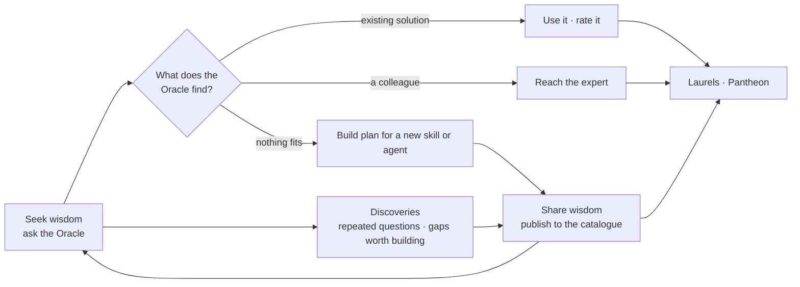

# **PYTHIA**

### **Your Oracle of Collective Wisdom**

**The answer you’re looking for might already exist. You just don’t know where to find it.**

Every day, people across an organisation solve problems, build useful tools, discover better ways of working, and gain valuable experience.

Yet much of that knowledge remains scattered across teams, projects, conversations, and individual minds.

**PYTHIA brings that collective knowledge together.**

Inspired by the ancient Oracle of Delphi, PYTHIA helps people find answers, discover expertise, share what they know, and connect with colleagues who can help.

Because sometimes the best answer isn’t generated by AI.

**It’s already somewhere in your organisation.**

> T1A Hackathon · *Inside the Crew*

Everything in this repository, including the demo data, is synthetic. No client data is used.

---

## **The Oracle**

At the heart of PYTHIA is the Oracle. Come seeking an answer or bringing knowledge of your own. Either way, the Oracle helps connect people, experience, and solutions.

### **Seek Wisdom**

Bring the Oracle a question, a challenge, or a problem you need to solve.

PYTHIA searches the knowledge available across your organisation to help you:

- **Find existing solutions** — discover tools, automations, guides, and reusable knowledge.
- **Connect with experts** — find colleagues with relevant skills and experience.
- **Explore new possibilities** — identify opportunities to create solutions where none exist.

### **Share Wisdom**

**What you know could be exactly what someone else needs.**

A project you’ve delivered. A problem you’ve solved. An automation you’ve built. A lesson you’ve learned.

Share your knowledge and experience with the Oracle. PYTHIA helps turn your contribution into discoverable expertise, project experience, or reusable solutions.

Review what PYTHIA finds, make any changes, and decide what to share.

**Your experience could be someone else’s answer.**

---

## **Explore PYTHIA**

### **Expertise**

**Find the people behind the knowledge.**

Sometimes the best solution starts with a conversation.

Expertise helps you discover colleagues through their professional skills, roles, practices, and project experience.

Find someone who knows a particular technology, understands an industry, or has already tackled a challenge similar to yours.

**Because knowing who to ask can be just as valuable as knowing the answer.**

### **Discoveries**

**See the bigger picture.**

One person struggling with a problem might be an isolated case.

Twenty people asking about the same challenge might reveal something worth solving.

**Discoveries helps organisations understand not only what they know, but what they need next.**

### **Pantheon**

**Celebrate those who make a difference.**

Some of the most valuable contributions in an organisation happen quietly.

A colleague shares a solution. Someone helps another team overcome a difficult challenge. An expert takes the time to explain something that others can now reuse.

The Pantheon makes these contributions visible.

Through recognition and laurels, PYTHIA celebrates people who share useful knowledge, help colleagues, and contribute solutions that create value beyond their original purpose.

**It’s not about who shares the most. It’s about whose knowledge helps others.**

### **Calendar Breather**

A catalogue agent that looks after the people who use it. After you connect your Google account, it analyses the next seven days of your calendar once a day or once a week and quietly adds a few **tentative recovery breaks** of 5 to 15 minutes in free weekday slots.

You choose a *Gentle*, *Balanced*, or *Extra room* mode; PYTHIA decides how many breaks you need and where to put them. You **accept** a break to confirm the hold or **decline** it to remove the hold. You can respond one by one or use *Accept all* on the **Connections** page or the result page.

A *previous week* preview replays the analysis in read-only mode and never writes to your calendar. Optional context analysis, enabled by default and easy to switch off, lets the model take recent meeting tone into account.

### **Connections**

Connect the Google account you signed in with so Calendar Breather can read your availability, manage the Oracle analysis schedule, and show the list of **break invitations** waiting for your answer.

---

## **How knowledge flows through PYTHIA**

Every question can lead to an existing answer, a helpful colleague, or an opportunity to create something new. Shared knowledge returns to the catalogue, repeated needs become visible, and useful contributions are recognised.



---

## **Try it in five minutes**

You need no accounts and no API keys. In a terminal, from the project folder:

```sh
npm start
```

Open <http://localhost:3000>, choose a **demo persona** on the login page, and try:

1. **Oracle → Seek Wisdom.** Ask: *“How can I clean up a SAP export before importing it?”* The Oracle recommends the **SAP Export Cleaner** solution and colleagues who know SAP. Ask: *“Who knows Kubernetes cluster tuning?”* and it returns colleagues instead of a solution.
2. **Oracle → Share Wisdom.** Describe something you built or know, review the draft, and confirm it. Your profile and the catalogue are updated and indexed immediately.
3. **Discoveries.** Expand a request, inspect the gaps, and browse the full list of problems and solutions.
4. **Pantheon.** See whose contributions are helping others and check your own level.
5. **Expertise.** Search the directory for an area of expertise, system, role, or practice.

Without an LLM gateway, the Oracle uses **local keyword matching**, which is enough for the seeded examples. Calendar Breather requires a connected Google account.

The demo database is seeded to resemble a system used for several months, with synthetic colleagues, solutions, requests, and contribution history.

---

## **Quick start**

### Requirements

| Requirement | Notes |
| --- | --- |
| **Node.js 22.13 or newer** | Required for the built-in SQLite module. Check with `node --version`. |
| **Git** | Used to clone the repository. |
| A modern browser | Chrome, Edge, Firefox, or Safari. |
| *(optional)* OpenAI-compatible LLM gateway | Enables conversational answers, semantic search, extraction, and voice input. |
| *(optional)* Google Cloud OAuth client | Enables company sign-in and Calendar Breather. |

The application has no third-party runtime dependencies and no build step, so there is no `npm install` step.

```sh
git clone <repository-url> pythia
cd pythia
npm start
```

Then open <http://localhost:3000>.

The server listens on `127.0.0.1`, so the application is available only on your computer. On the first launch, it creates a local SQLite database and loads the synthetic demo data.

### Everyday commands

| Command | What it does |
| --- | --- |
| `npm start` | Start the application. |
| `npm run dev` | Start with automatic restart when source files change. |
| `npm run db:reset` | Archive the current local database and recreate it from the shared demo seed. Stop the application first. |
| `npm test` | Run the automated test suite without touching the local database. |

---

## **Configuration**

PYTHIA runs as an offline local demo without configuration. Optional integrations are configured in `.env` or `.env.local`; both files are excluded from Git and must never be committed.

Copy the template if you want to add integrations:

```sh
cp .env.example .env
```

Important settings:

| Variable | Used for |
| --- | --- |
| `LLM_BASE_URL` | Base URL of an OpenAI-compatible gateway. |
| `LLM_API_KEY` | Bearer token for gateway calls. |
| `LLM_MODEL` | Chat model used by the Oracle, Share Wisdom, and Calendar Breather. |
| `EMBEDDING_MODEL` | Embedding model used for semantic search. Defaults to `text-embedding-3-small`. |
| `TRANSCRIPTION_MODEL` | Speech-to-text model used by voice input. |
| `GOOGLE_CLIENT_ID` | OAuth client ID for sign-in and Connections. |
| `GOOGLE_CLIENT_SECRET` | OAuth client secret. Keep it outside Git. |
| `GOOGLE_REDIRECT_URI` | OAuth callback; defaults to `http://localhost:3000/auth/google/callback`. |
| `AUTH_ALLOWED_DOMAINS` | Company email domains allowed to sign in. |
| `AUTH_DEV_LOGIN` | Controls the local demo-persona login. |

Restart the application after changing configuration.

### With an LLM gateway

```dotenv
LLM_BASE_URL=https://your-gateway.example.com/v1
LLM_API_KEY=your-key
LLM_MODEL=your-chat-model
```

The gateway may provide:

- conversational recommendations for Seek Wisdom;
- semantic search over colleagues and solutions;
- extraction for Share Wisdom and profile drafting;
- Calendar Breather planning;
- voice transcription.

If a model capability is unavailable, PYTHIA falls back to local search, ranking, and extraction wherever possible.

See the [Oracle LLM setup guide](./Documentation/Setup/ORACLE-LLM-SETUP.md) for endpoint details and diagnostics.

### With Google

One Google OAuth client supports company sign-in and the separate **Connections → Connect Google** flow.

1. Create or select a project in [Google Cloud Console](https://console.cloud.google.com/) and enable the Google Calendar API.
2. Configure the OAuth consent screen and add the teammates who will test the application.
3. Create a **Web application** OAuth client with the redirect URI `http://localhost:3000/auth/google/callback`.
4. Add the client ID and secret to your local environment file and restart PYTHIA.
5. Sign in, open **Connections**, and connect the same Google account.

See the [Google setup guide](./Documentation/Setup/GOOGLE-SETUP.md) for scopes and troubleshooting.

---

## **Privacy and data handling**

- **Demo data is synthetic.** Never load client data into this prototype.
- **Names stay local.** Names, emails, locations, and contact details are not included in embeddings or sent to the language model. The model receives anonymous candidate IDs and professional context; names are resolved locally after returned IDs are validated.
- **Identity comes from the session.** A request can act only as the person who is signed in.
- **External model calls are optional.** When a gateway is configured, Seek messages, Share Wisdom text, selected professional profile fields, and recordings deliberately submitted for transcription may leave the machine. Do not enter sensitive personal or HR information.
- **Calendar context is controlled.** By default, the model receives sanitised workload and availability data. Optional context analysis may send a limited sample of meeting titles and related email subjects or snippets; attendee addresses and full email bodies are excluded.
- **Discoveries is aggregate.** It contains no names, and request wording is shown only after enough colleagues have asked about the same topic to protect individual privacy.

The complete boundary is described in the [current architecture](./Documentation/Architecture/ARCHITECTURE.md#privacy-boundary).

---

## **Technical overview**

PYTHIA is deliberately small and local-first:

- a Node.js HTTP server using built-in platform modules;
- a static HTML, CSS, and JavaScript interface;
- a local SQLite database;
- hybrid retrieval using exact search and optional embeddings;
- optional OpenAI-compatible LLM and transcription endpoints;
- optional Google sign-in, Calendar, and Gmail integrations;
- no framework, build step, or third-party runtime dependency.

### Project layout

```text
server.mjs               HTTP server, routes, SQLite schema, calendar scheduler
lib/
  auth/                  Google sign-in, sessions, profile gate
  oracle.mjs             Oracle chat and recommendation validation
  retrieval.mjs          Hybrid search: SQLite FTS5 and embeddings
  wisdom.mjs             Share Wisdom and profile extraction
  discoveries.mjs        Request grouping, outcomes, privacy rules
  gamification.mjs       Laurels, levels, reward caps
  calendar.mjs           Break planning and conflict rules
  google.mjs             Google OAuth, Calendar, and Gmail client
  expertise.mjs          Normalisation of areas of expertise
  transcription.mjs      Voice transcription through the gateway
public/                  Browser application and login page
seed/mockup-seed.json    Versioned synthetic demo data
scripts/reset-db.mjs     Local database reset command
test/                    Automated tests
Documentation/           Architecture, setup guides, plans, and reference material
data/                    Runtime database, tokens, and backups; excluded from Git
```

### Tests and contributing

```sh
npm test
```

The tests start the real server from a temporary copy of the source, so they never touch the developer’s local `data/` directory.

The working agreement for contributors — personal branches, merge requests into `dev`, documentation updates, and seed rules — is in [AGENTS.md](./AGENTS.md).

---

## **Status and limitations**

PYTHIA is currently a **local hackathon prototype** intended to run on one machine. It is not publicly hosted or ready to expose directly to the internet.

Automated tests cover the core flows, including authentication, retrieval and ranking, Oracle response validation, Share Wisdom rules, Discoveries privacy, laurels, and Calendar Breather planning.

Local fallbacks keep the core experience usable without an LLM gateway or Google connection. The interface indicates when a fallback is being used.

Not yet implemented:

- hosted multi-user deployment;
- role-based access control and production rate limiting;
- catalogue synchronisation with SecondStack;
- an MCP endpoint;
- execution of catalogue agents other than Calendar Breather.

Shared agents are currently discoverable catalogue records, not executable agents.

---

## **Documentation**

The full documentation index is in [Documentation/README.md](./Documentation/README.md).

| Document | Read it for |
| --- | --- |
| [Current architecture](./Documentation/Architecture/ARCHITECTURE.md) | Implemented and verified behaviour, data flow, privacy, and fallbacks. |
| [Target architecture](./Documentation/Architecture/PYTHIA-architecture-and-logic.md) | The broader product and system design. |
| [Gamification framework](./Documentation/Architecture/PYTHIA-gamification-framework.md) | Laurels, levels, and recognition rules. |
| [Oracle LLM setup](./Documentation/Setup/ORACLE-LLM-SETUP.md) | Gateway configuration and diagnostics. |
| [Google setup](./Documentation/Setup/GOOGLE-SETUP.md) | OAuth, scopes, and Calendar Breather setup. |
| [Implementation plans](./Documentation/Plans/) | Feature plans, audits, and implementation logs. |
